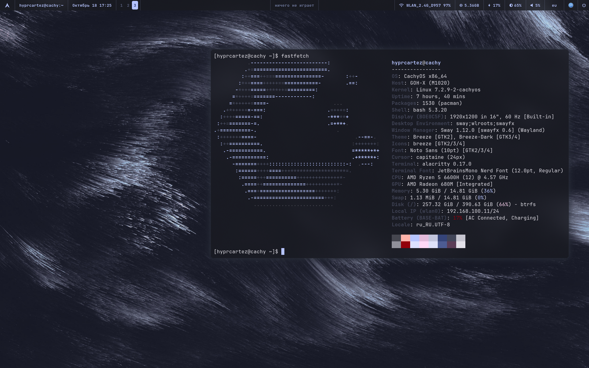

# swayfx-dotfiles

Русская версия — [README.ru.md](README.ru.md).

A complete SwayFX desktop for CachyOS/Arch: **quickshell** panels on top of **sway**,
a **waybar** bar, and a **Material You** theme that is generated from the wallpaper —
GTK, Qt, KDE, the terminals, waybar and the panels all follow it, light or dark.




## What's inside

```
~/.config/
├── sway/           compositor config (SwayFX), autostart, backlight helper
├── quickshell/     the shell: panels, settings, search, lock screen, wallpaper engine
│   ├── panels/       launcher, emoji, music, volume, brightness, wallpaper picker,
│   │                 settings (10 sections: look, language, apps, bar, keys, layouts…)
│   ├── scripts/      python helpers: search engine, app/bind/layout indexes, theming
│   ├── i18n/         interface languages: ru (source), en, uk, de
│   ├── lock/         lock screen (replaces swaylock)
│   └── docs/         screenshots
├── waybar/         bar config + scripts (window title, clock, media center, layout)
├── wallpaper/      wallpaper → palette → every app (theming engine)
├── alacritty/      terminal config (font, opacity, Qt theme via env)
├── kitty/          same for kitty
├── gtk-3.0/        GTK themes generated from the palette
├── gtk-4.0/
├── swaylock/       fallback lock screen config
├── wofi/           fallback launcher
├── xsettingsd/     GTK settings for non-GNOME apps
├── matugen/        config used to pull the palette out of the wallpaper
├── environment.d/  Qt apps follow GTK (QT_QPA_PLATFORMTHEME=gtk3)
└── .gitignore      whitelist — only the desktop is published, the rest stays private
```

## Requirements

* **CachyOS / Arch** with `swayfx` (SwayFX 0.6+, sway 1.12+) — plain sway works too,
  only the blur/shadow/corner-radius options would be ignored
* `waybar`, `quickshell` (0.3.2+), `python3` with **Pillow**, `jq`
* **JetBrainsMono Nerd Font** — the only font used
* terminals: `alacritty` and/or `kitty`
* helpers the config calls: `wofi`, `grim`, `slurp`, `wl-clipboard`, `brightnessctl`,
  `playerctl`, `wireplumber` (wpctl), `xdg-utils` (xdg-mime), `matugen`, `ffmpeg`,
  `gsettings` (glib2), `swayidle`, `swaylock-effects` (fallback lock)
* `plasma-apply-colorscheme` (plasma-workspace) — only to recolor KDE apps
* optional: [alacritty-theme](https://github.com/alacritty/alacritty-theme) —
  `git clone https://github.com/alacritty/alacritty-theme ~/.config/alacritty/themes`

## Install

The whole `~/.config` is a git repository, so clone it somewhere else and copy
the folders in (never clone over your own `~/.config`):

```sh
git clone https://github.com/c4rt3z/swayfx-dotfiles ~/swayfx-dotfiles
cd ~/swayfx-dotfiles
cp -r sway quickshell waybar wallpaper alacritty kitty matugen \
      gtk-3.0 gtk-4.0 swaylock wofi xsettingsd environment.d ~/.config/
```

Then:

1. put wallpapers into `~/Wallpapers` (any images and `.gif` — they animate);
2. **log out and back in** — `environment.d/10-qt.conf` is read at login, that's how
   Qt apps pick up the GTK theme;
3. start sway; the config starts waybar and quickshell itself
   (`exec_always` lines in `sway/config`);
4. paint everything from the wallpaper: `~/.config/wallpaper/wallpaper.sh random`
   or the wallpaper panel (`Super+Shift+W`);
5. brightness keys need one-time rights: `sudo bash ~/.config/sway/fix-backlight.sh`.

## Theming

```
wallpaper ──► wallpaper/theme-gen.sh ──► ~/.cache/wallpaper/theme/colors.json
                     │                          (Material You palette)
                     ├── gtk-3.0/gtk-4.0  colors.css, settings.ini
                     ├── alacritty, kitty         wallpaper.toml / theme.conf
                     ├── waybar                   style.css
                     ├── quickshell               Colors.qml reads colors.json
                     └── swaylock, wofi           same palette
```

`apps-theme.py sync` additionally flips every app between light and dark: the palette
luminance decides whether GTK, Qt and KDE use their light or dark variant, so a light
wallpaper gives light applications and a dark one gives dark applications. The
**Appearance** section of the settings can do the same thing by hand.

## Settings (`Super+,`)

One quickshell window, ten sections — everything writes straight into the configs:

| Section | What it does |
| --- | --- |
| Home | system summary and the repository link |
| Appearance | wallpaper, colour flavour, light/dark for every app |
| Language | interface language (ru, en, uk, de) and the region |
| Apps | theme for applications, GTK/Qt/KDE summary |
| Bar | waybar modules: what to show and where |
| Keys | every sway binding as `shortcut — command`, with rebinding |
| Layouts | keyboard layouts: enable, disable, pick the active one |
| Default applications | one application per task, Windows style (terminal, file manager, browser, editor, images, video, music, PDF, archives, mail) |
| Services | quickshell, waybar, swayidle, playerctld, wireplumber: state and restart |

### Rebinding keys

The **Keys** section lists the bindings exactly as they are written in
`~/.config/sway/config`. Click a row, change the shortcut (type it, or press
**press** and hit the combination) and/or the command, then save. The script changes
only that part of the line — indentation, options, comments and neighbours stay as
they are — and reloads sway. A shortcut that is already taken is never overwritten
silently: the settings offer to swap the two bindings instead. Every binding can be
put back the way it was (`as before`), and the snapshot for that lives in
`~/.config/quickshell/keys-default.json` (created on first run, not in this repo).

## Search (`Super+Space`)

Spotlight-like, sitting a quarter of the screen below the bar. It looks at
applications, open windows, files in your home folders, and does arithmetic
(`340*15%`). A query typed in the wrong keyboard layout is matched against the
right one, and one or two typos are forgiven (`trlegram` → Telegram). Enter runs
the first result, `Ctrl+1…9` the corresponding one.

## Languages

Russian is the source language — strings are written in Russian and translated
through `~/.config/quickshell/i18n/<code>.json` (fallback to English, then to
Russian). Shipped: `en`, `uk`, `de`. To add one: drop `<code>.json` next to them
and register the code in `singletons/Lang.qml` and in `waybar/scripts/waybar-lang.py`
(that one translates the bar's own module texts). Switching is instant, no restart.

## Key bindings

`Mod` is <kbd>Super</kbd>. The full list, as it sits in `sway/config`:

**Quickshell**

| Shortcut | Command |
| --- | --- |
| `Super+.` | `exec sh -c 'python3 $HOME/.config/quickshell/scripts/emoji-anchor.py; qs ipc call panel toggle emoji'` |

**Lock**

| Shortcut | Command |
| --- | --- |
| `Super+Ctrl+Shift+L` | `exec swaylock --config ~/.config/swaylock/config` |

**Brightness**

| Shortcut | Command |
| --- | --- |
| `Brightness+` | `exec brightnessctl set +5%` |
| `Brightness−` | `exec brightnessctl set 5%-` |

**Sound and media**

| Shortcut | Command |
| --- | --- |
| `Microphone` | `exec wpctl set-source-mute \@DEFAULT_SOURCE@ toggle` |
| `Mute` | `exec wpctl set-mute @DEFAULT_AUDIO_SINK@ toggle` |
| `Next track` | `exec playerctl -p playerctld next` |
| `Play/pause` | `exec playerctl -p playerctld play-pause` |
| `Previous track` | `exec playerctl -p playerctld previous` |
| `Volume+` | `exec wpctl set-volume @DEFAULT_AUDIO_SINK@ 5%+` |
| `Volume−` | `exec wpctl set-volume @DEFAULT_AUDIO_SINK@ 5%-` |
| `XF86AudioPause` | `exec playerctl -p playerctld play-pause` |
| `XF86AudioStop` | `exec playerctl -p playerctld stop` |

**Screenshots**

| Shortcut | Command |
| --- | --- |
| `Screenshot` | `exec sh -c 'grim "$HOME/Pictures/$(date +%Y-%m-%d_%H-%M-%S).png"'` |
| `Super+Shift+S` | `exec sh -c 'grim -g "$(slurp)" - \| wl-copy'` |

**Window**

| Shortcut | Command |
| --- | --- |
| `Super+Q` | `kill` |

**Focus**

| Shortcut | Command |
| --- | --- |
| `Super+Ctrl+Space` | `focus mode_toggle` |
| `Super+Down` | `focus down` |
| `Super+H` | `focus left` |
| `Super+J` | `focus down` |
| `Super+K` | `focus up` |
| `Super+L` | `focus right` |
| `Super+Left` | `focus left` |
| `Super+P` | `focus parent` |
| `Super+Right` | `focus right` |
| `Super+Up` | `focus up` |

**Transfer**

| Shortcut | Command |
| --- | --- |
| `Super+Shift+-` | `move scratchpad` |
| `Super+Shift+0` | `move container to workspace number 10` |
| `Super+Shift+1` | `move container to workspace number 1` |
| `Super+Shift+2` | `move container to workspace number 2` |
| `Super+Shift+3` | `move container to workspace number 3` |
| `Super+Shift+4` | `move container to workspace number 4` |
| `Super+Shift+5` | `move container to workspace number 5` |
| `Super+Shift+6` | `move container to workspace number 6` |
| `Super+Shift+7` | `move container to workspace number 7` |
| `Super+Shift+8` | `move container to workspace number 8` |
| `Super+Shift+9` | `move container to workspace number 9` |
| `Super+Shift+Down` | `move down` |
| `Super+Shift+H` | `move left` |
| `Super+Shift+J` | `move down` |
| `Super+Shift+K` | `move up` |
| `Super+Shift+L` | `move right` |
| `Super+Shift+Left` | `move left` |
| `Super+Shift+Right` | `move right` |
| `Super+Shift+Up` | `move up` |

**Size**

| Shortcut | Command |
| --- | --- |
| `Down` | `resize grow height 10px` |
| `H` | `resize shrink width 10px` |
| `J` | `resize grow height 10px` |
| `K` | `resize shrink height 10px` |
| `L` | `resize grow width 10px` |
| `Left` | `resize shrink width 10px` |
| `Right` | `resize grow width 10px` |
| `Up` | `resize shrink height 10px` |

**Layout**

| Shortcut | Command |
| --- | --- |
| `Super+G` | `splith` |
| `Super+M` | `layout tabbed` |
| `Super+S` | `layout stacking` |
| `Super+V` | `splitv` |
| `Super+Z` | `layout toggle split` |

**Workspaces**

| Shortcut | Command |
| --- | --- |
| `Super+0` | `workspace number 10` |
| `Super+1` | `workspace number 1` |
| `Super+2` | `workspace number 2` |
| `Super+3` | `workspace number 3` |
| `Super+4` | `workspace number 4` |
| `Super+5` | `workspace number 5` |
| `Super+6` | `workspace number 6` |
| `Super+7` | `workspace number 7` |
| `Super+8` | `workspace number 8` |
| `Super+9` | `workspace number 9` |

**Modes**

| Shortcut | Command |
| --- | --- |
| `Enter` | `mode "default"` |
| `Esc` | `mode "default"` |
| `Super+R` | `mode "resize"` |

**sway**

| Shortcut | Command |
| --- | --- |
| `Super+Shift+C` | `reload` |

**Other**

| Shortcut | Command |
| --- | --- |
| `Super+,` | `exec qs ipc call panel toggle settings` |
| `Super+-` | `scratchpad show` |
| `Super+A` | `exec qs ipc call panel open launcher` |
| `Super+B` | `exec firefox` |
| `Super+Ctrl+L` | `exec qs ipc call lock lock` |
| `Super+Ctrl+W` | `exec ~/.config/wallpaper/wallpaper.sh random` |
| `Super+E` | `exec dolphin` |
| `Super+Enter` | `exec alacritty` |
| `Super+F` | `fullscreen` |
| `Super+Shift+A` | `exec wofi --show drun` |
| `Super+Shift+E` | `exec swaynag -t warning -m 'You pressed the exit shortcut. Do you really want to exit sway? This will end your Wayland session.' -B 'Yes, exit sway' 'swaymsg exit'` |
| `Super+Shift+Space` | `floating toggle` |
| `Super+Shift+W` | `exec qs ipc call panel toggle wallpaper` |
| `Super+Space` | `exec qs ipc call panel toggle search` |
| `Super+W` | `floating toggle` |

## Notes

* SwayFX decorations are configured at the end of `sway/config`: no borders, 8px
  inner gaps, rounded corners, shadows and blur — including the blur under waybar
  and under the quickshell panels (`layer_effects`).
* GIF wallpapers are animated by the quickshell wallpaper engine, which caches
  frames (`wallpaper/gif-cache.sh`).
* The wallpaper panel, the search and the lock screen are quickshell windows, so a
  broken layout can be restarted with `pkill -x qs && qs`; `watchdog.sh` revives it
  automatically if it dies.
* Empty wallpaper folder? The panel says so — drop images into `~/Wallpapers`.
* `.gitignore` is a whitelist: only the folders listed under *What's inside* are
  published, everything else in `~/.config` (mail, messengers, keys, KDE state)
  stays out.

## Credits

Wallpaper theme engine, panels, scripts and translations by
[c4rt3z](https://github.com/c4rt3z). Built on [swayfx](https://github.com/Will-Lem/swayfx),
[quickshell](https://quickshell.org), [waybar](https://github.com/Alexays/Waybar) and
[matugen](https://github.com/InioX/matugen).
