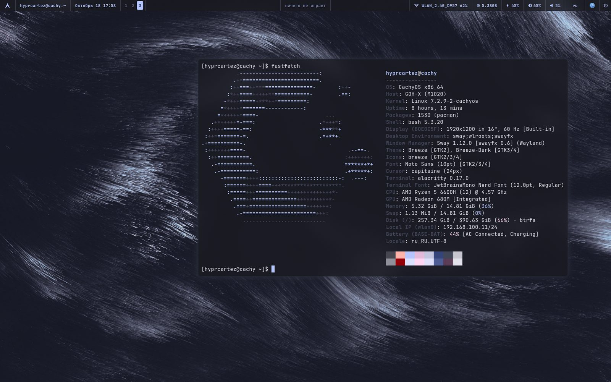
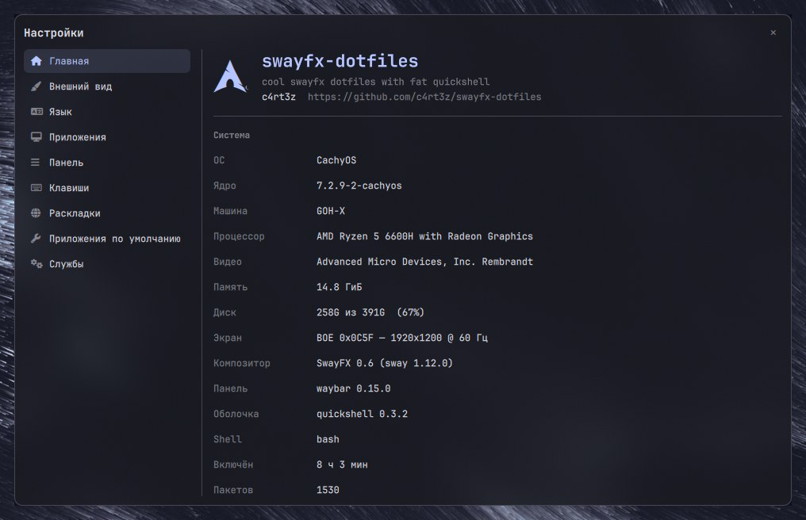

# swayfx-dotfiles

Русская версия — [README.ru.md](README.ru.md).

A complete SwayFX desktop for Arch/Arch-based distros: **quickshell** panels on top of **sway**,
a **waybar** bar, and a **Material You** theme that is generated from the wallpaper —
GTK, Qt, KDE, the terminals, waybar and the panels all follow it, light or dark.





[](https://github.com/c4rt3z/swayfx-dotfiles/blob/main/quickshell/docs/material-you.mp4)

**[Demo video, 26 s, 39 MB](https://github.com/c4rt3z/swayfx-dotfiles/blob/main/quickshell/docs/material-you.mp4)** —
Material You rebuilds the whole palette from every wallpaper, and animated GIF wallpapers keep animating.

## What's inside

```
~/.config/
├── sway/           compositor config (SwayFX), autostart, backlight helper
├── quickshell/     the shell: panels, settings, search, lock screen, wallpaper engine
│   ├── panels/       launcher, emoji, music, volume, brightness, wallpaper picker,
│   │                 settings (10 sections: look, language, apps, bar, keys, layouts…)
│   ├── scripts/      python helpers: search engine, app/bind/layout indexes, theming
│   ├── i18n/         interface languages: ru (source), en, uk, de
│   ├── sidebar/      sidebar: clipboard, screenshots, session tiles
│   ├── toasts/       notification popups (quickshell is the notifier daemon)
│   ├── lock/         lock screen (replaces swaylock)
│   └── docs/         screenshots
├── waybar/         bar config + scripts (window title, clock, media center, layout)
├── wallpaper/      wallpaper → palette → every app (theming engine)
├── alacritty/      terminal config (font, opacity, Qt theme via env)
├── kitty/          same for kitty
├── gtk-3.0/        GTK themes generated from the palette
├── gtk-4.0/
├── swaylock/       fallback lock screen config
├── wofi/           fallback launcher
├── xsettingsd/     GTK settings for non-GNOME apps
├── matugen/        config used to pull the palette out of the wallpaper
├── environment.d/  Qt apps follow GTK (QT_QPA_PLATFORMTHEME=gtk3)
├── install.sh      installer: packages, backup, copy into ~/.config
├── LICENSE         MIT
└── .gitignore      whitelist — only the desktop is published, the rest stays private
```

## Requirements

* **Arch / Arch-based distro** with `swayfx` (SwayFX 0.6+, sway 1.12+) — plain sway works too,
  only the blur/shadow/corner-radius options would be ignored
* `waybar`, `quickshell` (0.3.2+), `python3` with **Pillow**, `jq`
* **JetBrainsMono Nerd Font** — the only font used
* terminals: `alacritty` and/or `kitty`
* helpers the config calls: `wofi`, `grim`, `slurp`, `wl-clipboard`, `tesseract` (optional —
  text recognition for screenshots), `brightnessctl`,
  `playerctl`, `wireplumber` (wpctl), `xdg-utils` (xdg-mime), `matugen`, `ffmpeg`,
  `gsettings` (glib2), `swayidle`, `swaylock-effects` (fallback lock),
  `easyeffects` (sound equalizer and presets)
* `plasma-apply-colorscheme` (plasma-workspace) — only to recolor KDE apps
* optional: [alacritty-theme](https://github.com/alacritty/alacritty-theme) —
  `git clone https://github.com/alacritty/alacritty-theme ~/.config/alacritty/themes`

## Install

> **The installer is still rough.** It has not been tested on a clean system yet,
> so surprises are possible. Start with the plan — `./install.sh --dry-run` — and
> keep the `~/.config-backup-<date>` it makes. Bug reports are welcome in
> [issues](https://github.com/c4rt3z/swayfx-dotfiles/issues).

The installer does the boring part: checks the packages, backs up whatever you
already had and lays the files out in `~/.config`:

```sh
git clone https://github.com/c4rt3z/swayfx-dotfiles ~/swayfx-dotfiles
cd ~/swayfx-dotfiles
./install.sh
```

It first asks for the output language (Russian or English, default from your
locale). Then it refuses to run as root (the configs have to stay yours),
installs only the missing packages with `pacman` (it will ask for your sudo
password) and moves everything it replaces into `~/.config-backup-<date>/`. Its
keys:

| key | what it does |
| --- | --- |
| `--dry-run` | print the plan, change nothing |
| `--yes` | don't ask, agree to everything |
| `--no-deps` | skip the package check |
| `--lang ru\|en` | output language, otherwise it asks |
| `--config-dir DIR` | install into DIR instead of `~/.config` |

No clone needed if you like one-liners (the script fetches the sources itself):

```sh
curl -fsSL https://github.com/c4rt3z/swayfx-dotfiles/raw/main/install.sh | bash
```

By hand, if you prefer — the whole `~/.config` is a git repository, so clone it
somewhere else and copy the folders in (never clone over your own `~/.config`):

```sh
git clone https://github.com/c4rt3z/swayfx-dotfiles ~/swayfx-dotfiles
cd ~/swayfx-dotfiles
cp -r sway quickshell waybar wallpaper alacritty kitty matugen \
      gtk-3.0 gtk-4.0 swaylock wofi xsettingsd environment.d ~/.config/
```

Then, either way:

1. put wallpapers into `~/Wallpapers` (any images and `.gif` — they animate);
2. **log out and back in** — `environment.d/10-qt.conf` is read at login, that's how
   Qt apps pick up the GTK theme;
3. start sway; the config starts waybar and quickshell itself
   (`exec_always` lines in `sway/config`);
4. paint everything from the wallpaper: `~/.config/wallpaper/wallpaper.sh random`
   or the wallpaper panel (`Super+Shift+W`); no wallpapers yet? a ready-made
   scheme works too: `~/.config/wallpaper/wallpaper.sh scheme nord`;
5. brightness keys need one-time rights: `sudo bash ~/.config/sway/fix-backlight.sh`.

### Updating

The clone is a normal git repository: pull it and run the installer again. It
backs up whatever it replaces and keeps your personal bits — the interface
language and the "as it was" snapshot of the key bindings:

```sh
cd ~/swayfx-dotfiles
git pull
./install.sh
```

## Theming

```
wallpaper ──► wallpaper/theme-gen.sh ──► ~/.cache/wallpaper/theme/colors.json
                     │                          (Material You palette)
                     ├── gtk-3.0/gtk-4.0  colors.css, settings.ini
                     ├── alacritty, kitty         wallpaper.toml / theme.conf
                     ├── waybar                   style.css
                     ├── quickshell               Colors.qml reads colors.json
                     └── swaylock, wofi           same palette
```

**Slideshow and parallax.** The wallpaper panel (`Super+Shift+W`) has a
“slideshow: on/off” switch in its bottom row: one click starts it, and the
interval next to it cycles through 5, 15, 30, 60 and 120 minutes. The shell
changes the wallpaper itself; the state lives in
`~/.config/wallpaper/slideshow.json`, and the terminal equivalent is
`wallpaper/slideshow.sh on 30`. The wallpaper also drifts slightly with the
cursor: parallax runs while the pointer is over the desktop.

**Blur.** The waybar and quickshell panels blur what is behind them (`layer_effects`
blocks in `~/.config/sway/config`, toggled in “Bar” → “Blur”), and so do the
notification toasts. The bar’s blur follows its shape instead of covering a
rectangle: the `layer_effects "waybar"` block has `blur_ignore_transparent`, so
a rounded island blurs exactly its own area. The lock screen is a session surface rather than a layer, so
the shell blurs its wallpaper itself (in QML), animated GIFs and video included;
under the clock it shows the battery charge and the track that is playing.

`apps-theme.py sync` additionally flips every app between light and dark: the palette
luminance decides whether GTK, Qt and KDE use their light or dark variant, so a light
wallpaper gives light applications and a dark one gives dark applications. The
**Appearance** section of the settings can do the same thing by hand.

## Settings (`Super+,`)

One quickshell window, twelve sections — everything writes straight into the
configs. At the top, across the full width, there is a search: it matches names
and meaning (“шрифт” → “Appearance”, “эквалайзер” → “Sound”, “буфер” →
“Sidebar”); Enter opens the first match.

| Section | What it does |
| --- | --- |
| Home | system summary and the repository link |
| Appearance | wallpaper, colour flavour, light/dark for every app, fonts (global, panels, waybar) |
| Language | interface language (ru, en, uk, de) and the region |
| Apps | theme for applications, GTK/Qt/KDE summary |
| Bar | waybar modules: what to show and where; bar position (top or bottom), look (solid, floating island, no background) and blur |
| Sidebar | screen side, width, button labels, tile grid (2×3 or 3×2) and widgets: weather, track, session, shots, clipboard |
| Weather | source (open-meteo without a key, or an OpenWeather key), city, units |
| Sound | volume, output device, sound card profiles and the EasyEffects equalizer: presets, bypass, service |
| Animations | windows (swayfx), panels, sidebar and notifications: duration and switches |
| Keys | every sway binding as `shortcut — command`, with rebinding |
| Layouts | keyboard layouts: enable, disable, pick the active one |
| Default applications | one application per task, Windows style (terminal, file manager, browser, editor, images, video, music, PDF, archives, mail) |
| Services | quickshell, waybar, swayidle, playerctld, wireplumber: state and restart |

### Rebinding keys

The **Keys** section lists the bindings exactly as they are written in
`~/.config/sway/config`. Click a row, change the shortcut (type it, or press
**press** and hit the combination) and/or the command, then save. The script changes
only that part of the line — indentation, options, comments and neighbours stay as
they are — and reloads sway. A shortcut that is already taken is never overwritten
silently: the settings offer to swap the two bindings instead. Every binding can be
put back the way it was (`as before`), and the snapshot for that lives in
`~/.config/quickshell/keys-default.json` (created on first run, not in this repo).

## Search (`Super+Space`)

Spotlight-like, sitting a quarter of the screen below the bar. It looks at
applications, open windows, files in your home folders, application menu entries
(actions from `.desktop`: “Steam — Big Picture”, “Spectacle — capture area”) and
does arithmetic (`340*15%`). A query typed in the wrong keyboard layout is
matched against the right one, one or two typos are forgiven (`trlegram` →
Telegram), and what you picked before ranks higher (history in
`~/.cache/quickshell/search-history.txt`).

Three more things right in the search field:

* **units** — `10 km in miles`, `2 kg in pounds`, `70 f to c`;
* **currencies** — `100 usd in rub`, rates from open.er-api.com cached for six
  hours;
* **translation** — `*hello world` translates into your interface language,
  `*привет мир` into English. Enter copies the answer (MyMemory, Google as a
  fallback).

Enter runs the first result, `Ctrl+1…9` the corresponding one.

## Languages

Russian is the source language — strings are written in Russian and translated
through `~/.config/quickshell/i18n/<code>.json` (fallback to English, then to
Russian). Shipped: `en`, `uk`, `de`. To add one: drop `<code>.json` next to them
and register the code in `singletons/Lang.qml` and in `waybar/scripts/waybar-lang.py`
(that one translates the bar's own module texts). Switching is instant, no restart.

## Sidebar, weather and calendar

`Super+D` (or `Super+\``) opens the **sidebar** — a panel one quarter of the
screen wide. It is configured in `Super+,` → “Sidebar”: which side of the screen
it uses (left or right), its width (16–40% of the screen), whether session
buttons keep their labels, whether tiles come 2×3 or 3×2, and which blocks are
enabled — weather, “now playing”, session, shots, clipboard. The settings live in
`~/.config/quickshell/sidebar.json` and apply on the spot.

At the top it shows **weather** (a large icon, the temperature, the description,
and below it the city, the “feels like” value and the wind; a click opens the
weather panel) and **“now playing”** — cover, title, artist and a pause button
(it stops the track without opening the player; a click on the card itself opens
the player). Then come the blocks:

* **session** — tiles two per row: lock, switch user, suspend, log out, reboot
  and power off. Dangerous actions ask for a second click;
* **screenshots** — four buttons (region, window, whole screen, in three
  seconds) and a strip of recent shots: copy, open, delete;
* **recent notifications** — what came in lately: app, title and text; a click
  copies the text to the clipboard;
* **clipboard** — history of text and images. No extra package needed:
  `wl-paste --watch` feeds `quickshell/scripts/clipboard.py`, which keeps the
  history. A copied screenshot lands here too. The cross next to an entry removes
  it from the history, “clear” removes them all.

Shots go to `~/Pictures/Screenshots`, are copied to the clipboard right away and
shown in a notification. Text recognition needs `tesseract` (optional; for
Russian also `tesseract-data-rus`).

**Weather** — the leftmost module after the logo: a font icon (Nerd Font, not an
emoji) and the temperature. The source is set in `Super+,` → “Weather”:
open-meteo needs no key and no signup, an OpenWeather key switches to their
data. The city is searched there too, units are °C/°F.

Weather and time are separate: clicking the temperature opens **weather**,
clicking the clock opens **calendar with the timer**. Weather shows the current
conditions plus a five-day forecast (icon, description, min and max) — click the
weather module in the bar or `qs ipc call panel bar weather`. Every widget opened
from waybar lands exactly under its own button (the shell takes its position from
the cursor), or above it when the bar sits at the bottom.

**Smooth caret** — in every input field (search, settings, launcher, timer) the
caret does not jump but glides to its new place, like in recent Word; the text
itself is left alone and nothing is drawn over it.

**Calendar and timers** — click the clock in the bar (or `Super+C`): a month with
today highlighted and timers. There can be **several at once**, each with its own
countdown, progress bar, pause and reset. Presets from 1 to 45 minutes plus a
field for your own time: `25` for minutes, `25:30` for minutes and seconds,
`1:05:00` for hours, minutes, seconds. The countdowns live in the shell, so the
panel can be closed — a notification arrives at zero.

**Battery** (click the charge icon in the bar) — percentage, time to full or
empty, and an “Auto-lock when idle” switch: it turns off the five-minute idle
screen lock without touching the lock before sleep. It applies right away
(`quickshell/scripts/autolock.sh` restarts `swayidle` if it was still running
the command from an older config).

**Icons and cursors** live there too, under “Appearance”: the list of installed
icon themes (`~/.local/share/icons`, `/usr/share/icons`) and cursor themes, the
current ones are marked, and a click applies them right away through gsettings.

**Fonts** — `Super+,` → “Appearance”, below the “Fonts” rule. The list comes
from fontconfig (searchable, each name drawn in its own face); you can set one
font for every interface, override it for quickshell panels and for waybar, and
reset to `JetBrainsMono Nerd Font`. Applied on the spot, no shell restart. The
font must carry Nerd Font icons, otherwise glyphs turn into squares. Stored in
`~/.config/quickshell/fonts.json`.

**Notifications** — quickshell’s own toasts: the shell is the
`org.freedesktop.Notifications` daemon itself, so dunst or swaync are not needed.
Cards appear under the bar on the right (the background behind the card is
blurred), fade after five seconds (or whatever the app asks for), important ones
stay until dismissed, hovering pauses the timer, and app-provided buttons
(“Open”, “Reply”) are shown too.

**Sound** — `Super+,` → “Sound”: volume and mute, output device, sound card
profiles (analog stereo, headphones, pro audio) and the equalizer. The equalizer
is not ours: the page drives EasyEffects — it starts and stops its service
(`easyeffects --service-mode`), toggles the effects bypass and loads presets from
`~/.local/share/easyeffects/output`. When there are no presets, the page offers
to open EasyEffects and add them there (the community keeps ready-made sets, for
example `github.com/M0Rf30/easyeffects-presets`). All of it is done by
`quickshell/scripts/audio.py`, which also works from the terminal:
`audio.py sink <device>`, `audio.py preset <name>`, `audio.py bypass on`.

**Animations** live in `Super+,` → “Animations”. Windows fade in and out (that
is swayfx — the duration is a slider and applies live through
`swaymsg animation_duration_ms`), quickshell panels fade in with a slight scale,
the sidebar slides in from the edge and notifications slide in from the right.
Every switch can be turned off; the settings live in
`~/.config/quickshell/animations.json`. Waybar animates its own hover highlight
and workspace changes too — through CSS transitions.

**The bar (waybar)** is configured in the same place, under “Bar”: modules and
their zones, position (top or bottom), look — solid, a rounded floating island,
or no background at all — and blur. The look buttons carry a miniature: you can
see how the bar will look and where it will sit when the bar is at the bottom. The look is stored in `~/.config/waybar/mode`,
the position and margins in `~/.config/waybar/config`; the quickshell panels and
the sidebar keep to the same side as the bar. In floating mode the island is
rounded at both ends, and the edge modules are rounded with it, so a hovered
background never sticks out of the curve.

**A widget opened from the bar** lands exactly under the middle of the button you
clicked, not “wherever the pointer happened to be”: the shell takes a picture of
the bar strip (`quickshell/scripts/bar-geometry.py`), finds the “icon + label”
blocks in it and picks the one nearest the click. The panel always stays under
the bar (or above it when the bar sits at the bottom) and never covers the bar
itself.

**Deep links to settings**: `qs ipc call settings open sound` opens the
settings right on that section (home, appearance, language, apps, bar, sidebar,
weather, sound, keys, languages, defaults, services).

## Key bindings

`Mod` is <kbd>Super</kbd>. The full list, as it sits in `sway/config`:

**Quickshell**

| Shortcut | Command |
| --- | --- |
| `Super+.` | `exec sh -c 'python3 $HOME/.config/quickshell/scripts/emoji-anchor.py; qs ipc call panel toggle emoji'` |

**Lock**

| Shortcut | Command |
| --- | --- |
| `Super+Ctrl+Shift+L` | `exec swaylock --config ~/.config/swaylock/config` |

**Brightness**

| Shortcut | Command |
| --- | --- |
| `Brightness+` | `exec brightnessctl set +5%` |
| `Brightness−` | `exec brightnessctl set 5%-` |

**Sound and media**

| Shortcut | Command |
| --- | --- |
| `Microphone` | `exec wpctl set-source-mute \@DEFAULT_SOURCE@ toggle` |
| `Mute` | `exec wpctl set-mute @DEFAULT_AUDIO_SINK@ toggle` |
| `Next track` | `exec playerctl -p playerctld next` |
| `Play/pause` | `exec playerctl -p playerctld play-pause` |
| `Previous track` | `exec playerctl -p playerctld previous` |
| `Volume+` | `exec wpctl set-volume @DEFAULT_AUDIO_SINK@ 5%+` |
| `Volume−` | `exec wpctl set-volume @DEFAULT_AUDIO_SINK@ 5%-` |
| `XF86AudioPause` | `exec playerctl -p playerctld play-pause` |
| `XF86AudioStop` | `exec playerctl -p playerctld stop` |

**Screenshots**

| Shortcut | Command |
| --- | --- |
| `Print` | `exec python3 $HOME/.config/quickshell/scripts/shot.py full` |
| `Shift+Print` | `exec python3 $HOME/.config/quickshell/scripts/shot.py region` |
| `Super+Print` | `exec python3 $HOME/.config/quickshell/scripts/shot.py window` |
| `Ctrl+Print` | `exec python3 $HOME/.config/quickshell/scripts/shot.py full 3` |
| `Super+Shift+S` | `exec python3 $HOME/.config/quickshell/scripts/shot.py region` |

**Window**

| Shortcut | Command |
| --- | --- |
| `Super+Q` | `kill` |

**Focus**

| Shortcut | Command |
| --- | --- |
| `Super+Ctrl+Space` | `focus mode_toggle` |
| `Super+Down` | `focus down` |
| `Super+H` | `focus left` |
| `Super+J` | `focus down` |
| `Super+K` | `focus up` |
| `Super+L` | `focus right` |
| `Super+Left` | `focus left` |
| `Super+P` | `focus parent` |
| `Super+Right` | `focus right` |
| `Super+Up` | `focus up` |

**Transfer**

| Shortcut | Command |
| --- | --- |
| `Super+Shift+-` | `move scratchpad` |
| `Super+Shift+0` | `move container to workspace number 10` |
| `Super+Shift+1` | `move container to workspace number 1` |
| `Super+Shift+2` | `move container to workspace number 2` |
| `Super+Shift+3` | `move container to workspace number 3` |
| `Super+Shift+4` | `move container to workspace number 4` |
| `Super+Shift+5` | `move container to workspace number 5` |
| `Super+Shift+6` | `move container to workspace number 6` |
| `Super+Shift+7` | `move container to workspace number 7` |
| `Super+Shift+8` | `move container to workspace number 8` |
| `Super+Shift+9` | `move container to workspace number 9` |
| `Super+Shift+Down` | `move down` |
| `Super+Shift+H` | `move left` |
| `Super+Shift+J` | `move down` |
| `Super+Shift+K` | `move up` |
| `Super+Shift+L` | `move right` |
| `Super+Shift+Left` | `move left` |
| `Super+Shift+Right` | `move right` |
| `Super+Shift+Up` | `move up` |

**Size**

| Shortcut | Command |
| --- | --- |
| `Down` | `resize grow height 10px` |
| `H` | `resize shrink width 10px` |
| `J` | `resize grow height 10px` |
| `K` | `resize shrink height 10px` |
| `L` | `resize grow width 10px` |
| `Left` | `resize shrink width 10px` |
| `Right` | `resize grow width 10px` |
| `Up` | `resize shrink height 10px` |

**Layout**

| Shortcut | Command |
| --- | --- |
| `Super+G` | `splith` |
| `Super+M` | `layout tabbed` |
| `Super+S` | `layout stacking` |
| `Super+V` | `splitv` |
| `Super+Z` | `layout toggle split` |

**Workspaces**

| Shortcut | Command |
| --- | --- |
| `Super+0` | `workspace number 10` |
| `Super+1` | `workspace number 1` |
| `Super+2` | `workspace number 2` |
| `Super+3` | `workspace number 3` |
| `Super+4` | `workspace number 4` |
| `Super+5` | `workspace number 5` |
| `Super+6` | `workspace number 6` |
| `Super+7` | `workspace number 7` |
| `Super+8` | `workspace number 8` |
| `Super+9` | `workspace number 9` |

**Modes**

| Shortcut | Command |
| --- | --- |
| `Enter` | `mode "default"` |
| `Esc` | `mode "default"` |
| `Super+R` | `mode "resize"` |

**sway**

| Shortcut | Command |
| --- | --- |
| `Super+Shift+C` | `reload` |

**Other**

| Shortcut | Command |
| --- | --- |
| `Alt+Tab` | `exec qs ipc call panel toggle switcher` (window switcher) |
| `Alt+Shift+Tab` | `exec python3 $HOME/.config/quickshell/scripts/switcher.py prev` |
| `Super+,` | `exec qs ipc call panel toggle settings` |
| `Super+-` | `scratchpad show` |
| `Super+A` | `exec qs ipc call panel open launcher` |
| `Super+B` | `exec firefox` |
| `Super+C` | `exec qs ipc call panel toggle calendar` |
| `Super+D` | `exec qs ipc call sidebar toggle` |
| ``Super+` `` | `exec qs ipc call sidebar toggle` |
| `Super+Ctrl+L` | `exec qs ipc call lock lock` |
| `Super+Ctrl+W` | `exec ~/.config/wallpaper/wallpaper.sh random` |
| `Super+E` | `exec dolphin` |
| `Super+Enter` | `exec alacritty` |
| `Super+F` | `fullscreen` |
| `Super+Shift+A` | `exec wofi --show drun` |
| `Super+Shift+E` | `exec swaynag -t warning -m 'You pressed the exit shortcut. Do you really want to exit sway? This will end your Wayland session.' -B 'Yes, exit sway' 'swaymsg exit'` |
| `Super+Shift+Space` | `floating toggle` |
| `Super+Shift+W` | `exec qs ipc call panel toggle wallpaper` |
| `Super+Space` | `exec qs ipc call panel toggle search` |
| `Super+W` | `floating toggle` |

## Notes

* SwayFX decorations are configured at the end of `sway/config`: no borders, 8px
  inner gaps, rounded corners, shadows and blur — including the blur under waybar
  and under the quickshell panels (`layer_effects`). `blur_ignore_transparent`
  keeps the emoji picker honest: its surface covers the whole screen, but the blur
  stays under the card only.
* GIF wallpapers are animated by the quickshell wallpaper engine, which caches
  frames (`wallpaper/gif-cache.sh`).
* The wallpaper panel, the search and the lock screen are quickshell windows, so a
  broken layout can be restarted with `pkill -x qs && qs`; `watchdog.sh` revives it
  automatically if it dies.
* Empty wallpaper folder? The panel says so — drop images into `~/Wallpapers`.
* `.gitignore` is a whitelist: only the folders listed under *What's inside* are
  published, everything else in `~/.config` (mail, messengers, keys, KDE state)
  stays out.

## Credits

Wallpaper theme engine, panels, scripts and translations by
[c4rt3z](https://github.com/c4rt3z). Built on [swayfx](https://github.com/Will-Lem/swayfx),
[quickshell](https://quickshell.org), [waybar](https://github.com/Alexays/Waybar) and
[matugen](https://github.com/InioX/matugen).

Ideas and inspiration:

* [ilyamiro/serpantinum](https://github.com/ilyamiro/serpantinum) — the reference
  for the shell as a whole: a quickshell desktop with panels, search and a theme
  manager rather than plain dotfiles.
* [luisbocanegra/kde-material-you-colors](https://github.com/luisbocanegra/kde-material-you-colors) —
  the "wallpaper → Material You palette → every app" idea, the colour-variant set
  (vibrant, monochrome, neutral, fruit-salad…) and the template approach.
* [Material Color Utilities](https://github.com/material-foundation/material-color-utilities)
  (Google) — the colour maths behind Material You, used here through matugen.
* Colour schemes: [Catppuccin](https://github.com/catppuccin/catppuccin),
  [Nord](https://www.nordtheme.com/), [Dracula](https://draculatheme.com/),
  [Gruvbox](https://github.com/morhetz/gruvbox),
  [Everforest](https://github.com/sainnhe/everforest),
  [Kanagawa](https://github.com/rebelot/kanagawa.nvim),
  [Tokyo Night](https://github.com/folke/tokyonight.nvim),
  [Rosé Pine](https://github.com/rose-pine/rose-pine-theme) and
  [One Dark](https://github.com/atom/one-dark-syntax) — each keeps its own license.
* [JetBrains Mono](https://www.jetbrains.com/lp/mono/) with
  [Nerd Fonts](https://www.nerdfonts.com/) patches — the only font here.

## License

[MIT](LICENSE) © 2026 c4rt3z. Take it, change it, publish it — just keep the
copyright notice. Third-party colour schemes and cloned alacritty themes stay
under their own licenses.
