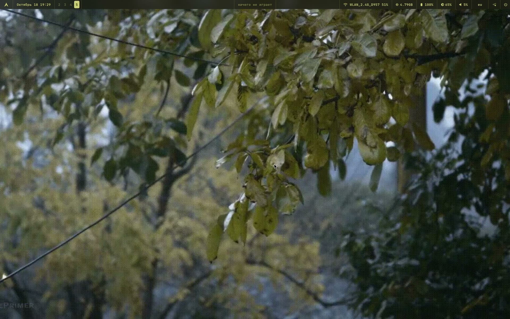

# swayfx-dotfiles

English version — [README.md](README.md).

Полностью готовый рабочий стол на SwayFX для Arch/Arch-based дистров: панели **quickshell**
поверх **sway**, бар на **waybar** и тема **Material You**, которая собирается из
обоев — GTK, Qt, KDE, терминалы, бар и панели следуют ей и переключаются между
светлым и тёмным видом вместе с обоями.


[](https://github.com/c4rt3z/swayfx-dotfiles/blob/main/quickshell/docs/material-you.mp4)

**[Видео-демонстрация, 26 с, 39 МБ](https://github.com/c4rt3z/swayfx-dotfiles/blob/main/quickshell/docs/material-you.mp4)** —
Material You пересобирает всю палитру под каждое фото, а анимированные GIF-обои продолжают анимироваться.

## Что внутри

```
~/.config/
├── sway/           конфиг композитора (SwayFX), автостарт, скрипт для яркости
├── quickshell/     оболочка: панели, настройки, поиск, экран блокировки, обои
│   ├── panels/       лаунчер, эмодзи, музыка, звук, яркость, выбор обоев,
│   │                 настройки (10 разделов: вид, язык, приложения, панель,
│   │                 клавиши, раскладки, приложения по умолчанию, службы…)
│   ├── scripts/      python: движок поиска, индексы приложений/биндов/раскладок
│   ├── i18n/         языки интерфейса: ru (исходный), en, uk, de
│   ├── sidebar/      сайдбар: буфер обмена, снимки экрана, кнопки сессии
│   ├── toasts/       всплывающие уведомления (демон — сам quickshell)
│   ├── lock/         экран блокировки (вместо swaylock)
│   └── docs/         скриншоты
├── waybar/         бар и его скрипты (заголовок окна, часы, медиацентр, раскладка)
├── wallpaper/      обои → палитра → все приложения (движок темы)
├── alacritty/      конфиг терминала (шрифт, прозрачность, тема Qt через env)
├── kitty/          то же для kitty
├── gtk-3.0/        GTK-темы, собранные из палитры
├── gtk-4.0/
├── swaylock/       запасной экран блокировки
├── wofi/           запасной лаунчер
├── xsettingsd/     GTK-настройки для программ вне GNOME
├── matugen/        конфиг, которым палитра вытаскивается из обоев
├── environment.d/  Qt-программы берут тему из GTK (QT_QPA_PLATFORMTHEME=gtk3)
├── install.sh      установщик: пакеты, бэкап, раскладка по ~/.config
├── LICENSE         MIT
└── .gitignore      белый список — в репозиторий идёт только рабочий стол
```

## Что нужно

* **Arch / Arch-based дистрибутив** со `swayfx` (SwayFX 0.6+, sway 1.12+) — обычный sway тоже
  подойдёт, просто блюр, тени и скругление углов останутся без эффекта
* `waybar`, `quickshell` (0.3.2+), `python3` с **Pillow**, `jq`
* шрифт **JetBrainsMono Nerd Font** — единственный, который используется
* терминалы: `alacritty` и/или `kitty`
* остальное, что зовёт конфиг: `wofi`, `grim`, `slurp`, `wl-clipboard`,
  `tesseract` (по желанию — распознавание текста со снимков),
  `brightnessctl`, `playerctl`, `wireplumber` (wpctl), `xdg-utils` (xdg-mime),
  `matugen`, `ffmpeg`, `gsettings` (glib2), `swayidle`, `swaylock-effects`
  (запасная блокировка), `easyeffects` (эквалайзер и пресеты звука)
* `plasma-apply-colorscheme` (plasma-workspace) — только чтобы красить KDE-программы
* по желанию: [alacritty-theme](https://github.com/alacritty/alacritty-theme) —
  `git clone https://github.com/alacritty/alacritty-theme ~/.config/alacritty/themes`

## Установка

> **Установщик пока сырой.** На чистой системе он ещё не проверялся, так что
> сюрпризы возможны. Начните с плана — `./install.sh --dry-run` — и не удаляйте
> бэкап `~/.config-backup-<дата>`, который он сделает. О поломках пишите в
> [issues](https://github.com/c4rt3z/swayfx-dotfiles/issues).

Всё скучное делает установщик: проверяет пакеты, делает бэкап того, что у вас
уже было, и раскладывает файлы по `~/.config`:

```sh
git clone https://github.com/c4rt3z/swayfx-dotfiles ~/swayfx-dotfiles
cd ~/swayfx-dotfiles
./install.sh
```

Сначала он спросит язык вывода (русский или английский, по умолчанию — по вашей
локали). От root он отказывается работать (конфиги должны остаться вашими),
недостающие пакеты ставит через `pacman` (спросит пароль sudo), а всё, что
заменяет, уносит в `~/.config-backup-<дата>/`. Ключи:

| ключ | что делает |
| --- | --- |
| `--dry-run` | показать план и ничего не менять |
| `--yes` | не задавать вопросов |
| `--no-deps` | не проверять пакеты |
| `--lang ru\|en` | язык вывода, иначе спросит |
| `--config-dir DIR` | поставить в DIR вместо `~/.config` |

Если хочется одной строкой (исходники скрипт скачает сам):

```sh
curl -fsSL https://github.com/c4rt3z/swayfx-dotfiles/raw/main/install.sh | bash
```

Руками, если так удобнее — весь `~/.config` это git-репозиторий, поэтому
клонируйте его в сторону и переносите папки (не клонируйте поверх своего
`~/.config`):

```sh
git clone https://github.com/c4rt3z/swayfx-dotfiles ~/swayfx-dotfiles
cd ~/swayfx-dotfiles
cp -r sway quickshell waybar wallpaper alacritty kitty matugen \
      gtk-3.0 gtk-4.0 swaylock wofi xsettingsd environment.d ~/.config/
```

Дальше — любым из двух способов:

1. положите обои в `~/Wallpapers` (любые картинки и `.gif` — они анимируются);
2. **перезайдите в сеанс** — `environment.d/10-qt.conf` читается при входе,
   именно так Qt-программы узнают про тему GTK;
3. запустите sway: бар и quickshell поднимутся сами (`exec_always` в `sway/config`);
4. раскрасьте всё из обоев: `~/.config/wallpaper/wallpaper.sh random` или панель
   обоев (`Super+Shift+W`); обоев пока нет? работает и готовая схема:
   `~/.config/wallpaper/wallpaper.sh scheme nord`;
5. клавишам яркости нужны права один раз: `sudo bash ~/.config/sway/fix-backlight.sh`.

### Обновление

Клон — это обычный git-репозиторий: обновите его и запустите установщик снова.
Он уносит в бэкап то, что заменяет, и сохраняет ваше личное — язык интерфейса и
снимок «как было» для горячих клавиш:

```sh
cd ~/swayfx-dotfiles
git pull
./install.sh
```

## Тема

```
обои ──► wallpaper/theme-gen.sh ──► ~/.cache/wallpaper/theme/colors.json
              │                          (палитра Material You)
              ├── gtk-3.0/gtk-4.0  colors.css, settings.ini
              ├── alacritty, kitty         wallpaper.toml / theme.conf
              ├── waybar                   style.css
              ├── quickshell               Colors.qml читает colors.json
              └── swaylock, wofi           та же палитра
```

**Слайд-шоу и параллакс.** В панели обоев (`Super+Shift+W`) в нижней строке есть
переключатель «слайд-шоу: вкл/выкл»: щелчок включает показ, рядом выбирается
интервал (5, 15, 30, 60, 120 минут). Обои меняет сама оболочка, а состояние
живёт в `~/.config/wallpaper/slideshow.json` — из терминала то же самое делает
`wallpaper/slideshow.sh on 30`. Обои чуть сдвигаются за курсором: параллакс
работает, пока указатель над рабочим столом.

**Размытие.** Фон размывают и панели waybar/quickshell (блоки `layer_effects` в
`~/.config/sway/config`, включаются в «Панель» → «Размытие»), и тосты
уведомлений. У полосы waybar размытие идёт по её форме, а не прямоугольником:
в блоке `layer_effects "waybar"` включён `blur_ignore_transparent`, поэтому
скруглённый островок размывает ровно свою площадь. Экран блокировки — не слой, а поверхность сессии, поэтому его обои
размывает сама оболочка (на QML), вместе с гифкой и видео; под часами видно
заряд батареи и играющий трек.

`apps-theme.py sync` вдобавок переключает приложения между светлым и тёмным: по
яркости палитры выбирается светлый или тёмный вариант GTK, Qt и KDE, поэтому на
светлых обоях программы светлые, на тёмных — тёмные. То же можно сделать руками в
разделе **Внешний вид**.

## Настройки (`Super+,`)

Одно окно quickshell, двенадцать разделов — всё пишется прямо в конфиги. Сверху,
во всю ширину окна, есть поиск по настройкам: он ищет и по названиям, и по
смыслу («шрифт» → «Внешний вид», «эквалайзер» → «Звук», «буфер» → «Сайдбар»);
Enter открывает первое найденное.

| Раздел | Что делает |
| --- | --- |
| Главная | сводка по системе и ссылка на репозиторий |
| Внешний вид | обои, набор цветов, светлое/тёмное для всех программ и шрифты (общий, панели, waybar) |
| Язык | язык интерфейса (ru, en, uk, de) и регион |
| Приложения | тема программ, сводка GTK/Qt/KDE |
| Панель | модули waybar: что показывать и где; положение бара (сверху или снизу), вид (сплошной, плавающий островок, без подложки) и размытие |
| Сайдбар | сторона экрана, ширина, подписи кнопок, сетка плиток (2×3 или 3×2) и виджеты: погода, трек, сессия, снимки, буфер |
| Погода | источник (open-meteo без ключа или ключ OpenWeather), город, единицы |
| Звук | громкость, устройство вывода, профили звуковой карты и эквалайзер EasyEffects: пресеты, обход, служба |
| Анимации | окна (swayfx), панели, сайдбар и уведомления: длительность и переключатели |
| Клавиши | все бинды sway в виде «сочетание — команда» с перебиндом |
| Раскладки | раскладки клавиатуры: включить, выключить, выбрать активную |
| Приложения по умолчанию | своё приложение под каждую задачу, как в Windows (терминал, файловый менеджер, браузер, редактор, изображения, видео, музыка, PDF, архивы, почта) |
| Службы | quickshell, waybar, swayidle, playerctld, wireplumber: состояние и перезапуск |

### Перебинд клавиш

Раздел **Клавиши** показывает бинды ровно так, как они записаны в
`~/.config/sway/config`. Щёлкните строку, поменяйте сочетание (набрать руками или
нажать **нажать** и нажать нужное) и/или команду, затем сохраните. Скрипт меняет
только эту часть строки — отступ, флаги, комментарии и соседние строки остаются
как были — и перечитывает конфиг sway. Занятое сочетание молча не отбирается:
настройки предложат поменять бинды местами. Любой бинд можно вернуть как было
(«как было»); снимок для этого лежит в `~/.config/quickshell/keys-default.json`
(создаётся при первом запуске, в репозиторий не входит).

## Поиск (`Super+Space`)

Как Spotlight, опущен на четверть экрана ниже бара. Ищет по приложениям, окнам,
файлам в домашних папках, пунктам меню приложений (действия из `.desktop`:
«Steam — Big Picture», «Spectacle — снимок области») и считает арифметику
(`340*15%`). Запрос в неверной раскладке сопоставляется с правильной, одна-две
опечатки прощаются (`trlegram` → Telegram). Что выбирали раньше — поднимается
выше (история в `~/.cache/quickshell/search-history.txt`).

Ещё три вещи прямо в строке поиска:

* **единицы** — `10 км в милях`, `2 кг в фунтах`, `70 f to c`, `1.5 л в галлонах`;
* **валюты** — `100 usd в rub`: курс берётся у open.er-api.com и живёт в кэше
  шесть часов, интернет нужен только для валют;
* **перевод** — `*привет мир` переводит на английский, `*hello world` — на язык
  интерфейса. Ответ копируется по Enter (MyMemory, запасной — Google).

Enter запускает первую строку, `Ctrl+1…9` — нужную.

## Языки

Исходный язык — русский: строки написаны по-русски и переводятся через
`~/.config/quickshell/i18n/<код>.json` (если перевода нет — английский, потом
русский). В комплекте `en`, `uk`, `de`. Чтобы добавить свой: положите рядом
`<код>.json` и допишите код в `singletons/Lang.qml` и в
`waybar/scripts/waybar-lang.py` (он переводит тексты модулей бара). Переключение
применяется сразу, перезапускать ничего не надо.

## Сайдбар, погода и календарь

`Super+D` (или `Super+\``) открывает **сайдбар** — панель шириной в четверть
экрана. Он настраивается в `Super+,` → «Сайдбар»: сторона экрана (слева или
справа), ширина (16–40% экрана), подписи у кнопок можно спрятать, плитки сессии
поставить 2×3 или 3×2, а блоки включать по одному — погода, «сейчас играет»,
кнопки сессии, снимки, буфер. Настройка живёт в
`~/.config/quickshell/sidebar.json`, применяется на месте.

Сверху панель показывает **погоду** (крупная иконка, температура, описание, а
ниже город, «ощущается» и ветер; щелчок открывает панель погоды) и **«сейчас
играет»** — обложку, название, исполнителя и кнопку паузы (она останавливает
трек, не открывая плеер; щелчок по самой карточке открывает плеер). Дальше идут
блоки:

* **сессия** — плитки по две в ряд: блокировка, смена пользователя, сон, выход,
  перезагрузка и выключение. Опасные действия просят второго нажатия;
* **снимки экрана** — четыре кнопки (область, окно, весь экран, через три
  секунды) и лента свежих снимков: копировать, открыть, удалить;
* **недавние уведомления** — что прилетало за последнее время: приложение,
  заголовок и текст; щелчок копирует текст в буфер;
* **буфер обмена** — история текста и картинок. Отдельный пакет не нужен:
  `wl-paste --watch` отдаёт содержимое скрипту `quickshell/scripts/clipboard.py`,
  тот и ведёт историю. Скопированный снимок экрана тоже попадает сюда.
  Крестик у элемента удаляет его из истории, «очистить» — всю.

Снимки кладутся в `~/Pictures/Screenshots`, сразу копируются в буфер и
показываются уведомлением. Распознавание текста работает, если установлен
`tesseract` (по желанию; для русского — ещё `tesseract-data-rus`).

**Погода** — крайний левый модуль после логотипа: иконка из шрифта (Nerd Font,
не эмодзи) и температура. Источник настраивается в `Super+,` → «Погода»:
open-meteo работает без ключа и регистрации, ключ OpenWeather включает их
данные. Там же ищется город и выбираются единицы (°C/°F).

Погода и время живут отдельно: клик по температуре открывает **погоду**, клик
по часам — **календарь с таймером**. Погода показывает текущие значения и
прогноз на пять дней (иконка, описание, минимум и максимум) — клик по модулю
погоды в баре или `qs ipc call panel bar weather`. Все виджеты, которые
открываются щелчком по waybar, встают ровно под своей кнопкой (оболочка берёт
её положение у курсора), а если бар снизу — над ним.

**Плавная каретка** — во всех полях ввода (поиск, настройки, лаунчер,
таймер) каретка не прыгает, а плавно переезжает на новое место, как в
свежем Word; сам текст при этом не трогаем и ничем не перекрываем.

**Календарь и таймер** — клик по часам в баре (или `Super+C`): месяц с
выделенным сегодняшним днём и таймер. Пресеты от 1 до 45 минут и своё время
руками: `25` — минуты, `25:30` — минуты и секунды, `1:05:00` — часы, минуты,
секунды. Отсчёт живёт в оболочке, поэтому панель можно закрыть — по нулю придёт
уведомление.

**Батарея** (клик по значку заряда в баре) — процент, время до полного или до
пустого и тумблер «Автоблокировка по простою»: выключает блокировку экрана
через пять минут простоя, не трогая блокировку перед сном. Действует сразу
(скрипт `quickshell/scripts/autolock.sh` перезапускает `swayidle`, если тот
ещё держал команду из старого конфига).

**Значки и курсоры** — там же, в «Внешний вид»: список установленных тем
значков (`~/.local/share/icons`, `/usr/share/icons`) и тем курсоров, текущие
отмечены, выбор применяется сразу через gsettings.

**Шрифты** — в настройках: `Super+,` → «Внешний вид», под чертой «Шрифты».
Список берётся из fontconfig (с поиском и примером начертания), можно задать
общий шрифт на все интерфейсы сразу, отдельно для панелей quickshell и отдельно
для waybar, и сбросить к `JetBrainsMono Nerd Font`. Выбор применяется на месте,
без перезапуска оболочки; bar пересобирает CSS сам. Шрифт должен содержать
иконки Nerd Font — иначе значки станут квадратами. Настройка живёт в
`~/.config/quickshell/fonts.json`.

**Уведомления** — свои тосты quickshell: оболочка сама выступает демоном
`org.freedesktop.Notifications`, поэтому dunst или swaync не нужны. Карточки
появляются справа сверху под баром (фон под карточкой размыт), гаснут через пять секунд (или сколько просит
приложение), важные висят до закрытия, курсор останавливает таймер, у приложений
с кнопками («Открыть», «Ответить») кнопки есть и в тосте.

**Звук** — `Super+,` → «Звук»: громкость и выключение звука, устройство
вывода, профили звуковой карты (аналоговый стерео, наушники, pro audio) и
эквалайзер. Эквалайзер не свой: страница ведёт EasyEffects — запускает и
останавливает его службу (`easyeffects --service-mode`), переключает обход
эффектов и загружает пресеты из `~/.local/share/easyeffects/output`. Если
пресетов нет, страница предлагает открыть EasyEffects и добавить их там (готовые
наборы собирает сообщество, например `github.com/M0Rf30/easyeffects-presets`).
Всё это делает `quickshell/scripts/audio.py`, он же работает из терминала:
`audio.py sink <устройство>`, `audio.py preset <имя>`, `audio.py bypass on`.

**Анимации** — в `Super+,` → «Анимации». Окна проявляются и гаснут (это
swayfx, длительность настраивается ползунком и применяется на ходу через
`swaymsg animation_duration_ms`), панели quickshell проявляются с лёгким
масштабом, сайдбар выезжает из-за края, а уведомления — справа. Каждый
переключатель можно выключить; настройки лежат в
`~/.config/quickshell/animations.json`. Сам waybar тоже анимирует подсветку при
наведении и смену рабочего стола — за счёт переходов в CSS.

**Бар (waybar)** настраивается там же, в «Панель»: модули и их зоны, положение
(сверху или снизу), вид — сплошной, плавающий островок со скруглением или вовсе
без подложки — и размытие. У кнопок выбора вида миниатюра: видно, как полоса
будет выглядеть, и где окажется, если бар снизу. Вид хранится в `~/.config/waybar/mode`, положение и
зазоры — в `~/.config/waybar/config`; панели quickshell и сайдбар встают с той
же стороны, что и бар. В плавающем режиме островок скруглён по краям, и крайние
модули скруглены вместе с ним, чтобы подложка при наведении не вылезала за
скругление.

Панели держатся той же стороны, что и бар: бар сверху — панели сверху, бар
снизу — панели уходят вниз, к бару (настройки и лаунчер остаются по центру).

**Виджет под кнопкой бара** встаёт строго под серединой той кнопки, по которой
щелкнули, а не «куда ткнули»: оболочка снимает полосу бара
(`quickshell/scripts/bar-geometry.py`), находит в ней блоки «иконка + подпись» и
выбирает ближайший к клику. Панель всегда под полосой (или над ней, если бар
снизу) и никогда не накрывает сам бар. Работает и для кнопок, которых нет в
waybar: положение считается по настоящей геометрии, а не по курсору.

**Ссылки на разделы настроек**: `qs ipc call settings open sound` открывает
настройки сразу на нужном разделе (home, appearance, language, apps, bar,
sidebar, weather, sound, keys, languages, defaults, services).

## Горячие клавиши

`Mod` — это <kbd>Super</kbd>. Полный список ровно в том виде, в каком он лежит в
`sway/config`:

**Quickshell**

| Сочетание | Команда |
| --- | --- |
| `Super+.` | `exec sh -c 'python3 $HOME/.config/quickshell/scripts/emoji-anchor.py; qs ipc call panel toggle emoji'` |

**Блокировка**

| Сочетание | Команда |
| --- | --- |
| `Super+Ctrl+Shift+L` | `exec swaylock --config ~/.config/swaylock/config` |

**Яркость**

| Сочетание | Команда |
| --- | --- |
| `Яркость+` | `exec brightnessctl set +5%` |
| `Яркость−` | `exec brightnessctl set 5%-` |

**Звук и медиа**

| Сочетание | Команда |
| --- | --- |
| `XF86AudioPause` | `exec playerctl -p playerctld play-pause` |
| `XF86AudioStop` | `exec playerctl -p playerctld stop` |
| `Громкость+` | `exec wpctl set-volume @DEFAULT_AUDIO_SINK@ 5%+` |
| `Громкость−` | `exec wpctl set-volume @DEFAULT_AUDIO_SINK@ 5%-` |
| `Микрофон` | `exec wpctl set-source-mute \@DEFAULT_SOURCE@ toggle` |
| `Плей/пауза` | `exec playerctl -p playerctld play-pause` |
| `Прошлый трек` | `exec playerctl -p playerctld previous` |
| `Следующий трек` | `exec playerctl -p playerctld next` |
| `Тишина` | `exec wpctl set-mute @DEFAULT_AUDIO_SINK@ toggle` |

**Скриншоты**

| Сочетание | Команда |
| --- | --- |
| `Print` | `exec python3 $HOME/.config/quickshell/scripts/shot.py full` |
| `Shift+Print` | `exec python3 $HOME/.config/quickshell/scripts/shot.py region` |
| `Super+Print` | `exec python3 $HOME/.config/quickshell/scripts/shot.py window` |
| `Ctrl+Print` | `exec python3 $HOME/.config/quickshell/scripts/shot.py full 3` |
| `Super+Shift+S` | `exec python3 $HOME/.config/quickshell/scripts/shot.py region` |

**Окно**

| Сочетание | Команда |
| --- | --- |
| `Super+Q` | `kill` |

**Фокус**

| Сочетание | Команда |
| --- | --- |
| `Super+Ctrl+Пробел` | `focus mode_toggle` |
| `Super+Down` | `focus down` |
| `Super+H` | `focus left` |
| `Super+J` | `focus down` |
| `Super+K` | `focus up` |
| `Super+L` | `focus right` |
| `Super+Left` | `focus left` |
| `Super+P` | `focus parent` |
| `Super+Right` | `focus right` |
| `Super+Up` | `focus up` |

**Перенос**

| Сочетание | Команда |
| --- | --- |
| `Super+Shift+-` | `move scratchpad` |
| `Super+Shift+0` | `move container to workspace number 10` |
| `Super+Shift+1` | `move container to workspace number 1` |
| `Super+Shift+2` | `move container to workspace number 2` |
| `Super+Shift+3` | `move container to workspace number 3` |
| `Super+Shift+4` | `move container to workspace number 4` |
| `Super+Shift+5` | `move container to workspace number 5` |
| `Super+Shift+6` | `move container to workspace number 6` |
| `Super+Shift+7` | `move container to workspace number 7` |
| `Super+Shift+8` | `move container to workspace number 8` |
| `Super+Shift+9` | `move container to workspace number 9` |
| `Super+Shift+Down` | `move down` |
| `Super+Shift+H` | `move left` |
| `Super+Shift+J` | `move down` |
| `Super+Shift+K` | `move up` |
| `Super+Shift+L` | `move right` |
| `Super+Shift+Left` | `move left` |
| `Super+Shift+Right` | `move right` |
| `Super+Shift+Up` | `move up` |

**Размер**

| Сочетание | Команда |
| --- | --- |
| `Down` | `resize grow height 10px` |
| `H` | `resize shrink width 10px` |
| `J` | `resize grow height 10px` |
| `K` | `resize shrink height 10px` |
| `L` | `resize grow width 10px` |
| `Left` | `resize shrink width 10px` |
| `Right` | `resize grow width 10px` |
| `Up` | `resize shrink height 10px` |

**Раскладка**

| Сочетание | Команда |
| --- | --- |
| `Super+G` | `splith` |
| `Super+M` | `layout tabbed` |
| `Super+S` | `layout stacking` |
| `Super+V` | `splitv` |
| `Super+Z` | `layout toggle split` |

**Рабочие столы**

| Сочетание | Команда |
| --- | --- |
| `Super+0` | `workspace number 10` |
| `Super+1` | `workspace number 1` |
| `Super+2` | `workspace number 2` |
| `Super+3` | `workspace number 3` |
| `Super+4` | `workspace number 4` |
| `Super+5` | `workspace number 5` |
| `Super+6` | `workspace number 6` |
| `Super+7` | `workspace number 7` |
| `Super+8` | `workspace number 8` |
| `Super+9` | `workspace number 9` |

**Режимы**

| Сочетание | Команда |
| --- | --- |
| `Enter` | `mode "default"` |
| `Esc` | `mode "default"` |
| `Super+R` | `mode "resize"` |

**sway**

| Сочетание | Команда |
| --- | --- |
| `Super+Shift+C` | `reload` |

**Прочее**

| Сочетание | Команда |
| --- | --- |
| `Alt+Tab` | `exec qs ipc call panel toggle switcher` (переключатель окон) |
| `Alt+Shift+Tab` | `exec python3 $HOME/.config/quickshell/scripts/switcher.py prev` |
| `Super+,` | `exec qs ipc call panel toggle settings` |
| `Super+-` | `scratchpad show` |
| `Super+A` | `exec qs ipc call panel open launcher` |
| `Super+B` | `exec firefox` |
| `Super+C` | `exec qs ipc call panel toggle calendar` |
| `Super+D` | `exec qs ipc call sidebar toggle` |
| ``Super+` `` | `exec qs ipc call sidebar toggle` |
| `Super+Ctrl+L` | `exec qs ipc call lock lock` |
| `Super+Ctrl+W` | `exec ~/.config/wallpaper/wallpaper.sh random` |
| `Super+E` | `exec dolphin` |
| `Super+Enter` | `exec alacritty` |
| `Super+F` | `fullscreen` |
| `Super+Shift+A` | `exec wofi --show drun` |
| `Super+Shift+E` | `exec swaynag -t warning -m 'You pressed the exit shortcut. Do you really want to exit sway? This will end your Wayland session.' -B 'Yes, exit sway' 'swaymsg exit'` |
| `Super+Shift+W` | `exec qs ipc call panel toggle wallpaper` |
| `Super+Shift+Пробел` | `floating toggle` |
| `Super+W` | `floating toggle` |
| `Super+Пробел` | `exec qs ipc call panel toggle search` |

## Мелочи

* Оформление SwayFX — в конце `sway/config`: рамок нет, отступы 8 внутри и 4 до
  краёв, скруглённые углы, тени и блюр, в том числе под waybar и под панелями
  quickshell (`layer_effects`). `blur_ignore_transparent` не даёт панели эмодзи
  размыть весь экран: её поверхность во весь экран, а блюр остаётся только под
  карточкой.
* GIF-обои анимируются движком обоев в quickshell, кадры кэшируются
  (`wallpaper/gif-cache.sh`).
* Панель обоев, поиск и экран блокировки — окна quickshell, поэтому сломавшуюся
  оболочку лечит `pkill -x qs && qs`; `watchdog.sh` поднимает её сам, если она
  упадёт.
* Папка обоев пуста — так и написано в панели, положите картинки в `~/Wallpapers`.
* `.gitignore` — белый список: публикуются только папки из «Что внутри», всё
  остальное в `~/.config` (почта, мессенджеры, ключи, состояние KDE) остаётся
  личным.

## Благодарности

Движок темы, панели, скрипты и переводы — [c4rt3z](https://github.com/c4rt3z).
Построено на [swayfx](https://github.com/Will-Lem/swayfx),
[quickshell](https://quickshell.org), [waybar](https://github.com/Alexays/Waybar) и
[matugen](https://github.com/InioX/matugen).

Идеи и вдохновение:

* [ilyamiro/serpantinum](https://github.com/ilyamiro/serpantinum) — ориентир для
  оболочки в целом: десктоп на quickshell с панелями, поиском и менеджером тем,
  а не просто дотфайлы.
* [luisbocanegra/kde-material-you-colors](https://github.com/luisbocanegra/kde-material-you-colors) —
  идея «обои → палитра Material You → все приложения», набор вариантов схемы
  (vibrant, monochrome, neutral, fruit-salad…) и подход с шаблонами.
* [Material Color Utilities](https://github.com/material-foundation/material-color-utilities)
  от Google — математика цвета Material You, здесь она работает через matugen.
* Готовые схемы: [Catppuccin](https://github.com/catppuccin/catppuccin),
  [Nord](https://www.nordtheme.com/), [Dracula](https://draculatheme.com/),
  [Gruvbox](https://github.com/morhetz/gruvbox),
  [Everforest](https://github.com/sainnhe/everforest),
  [Kanagawa](https://github.com/rebelot/kanagawa.nvim),
  [Tokyo Night](https://github.com/folke/tokyonight.nvim),
  [Rosé Pine](https://github.com/rose-pine/rose-pine-theme) и
  [One Dark](https://github.com/atom/one-dark-syntax) — у каждой своя лицензия.
* [JetBrains Mono](https://www.jetbrains.com/lp/mono/) с патчами
  [Nerd Fonts](https://www.nerdfonts.com/) — единственный шрифт здесь.

## Лицензия

[MIT](LICENSE) © 2026 c4rt3z. Берите, меняйте, публикуйте — только сохраните
копирайт. Сторонние схемы и склонированные темы alacritty остаются под своими
лицензиями.
